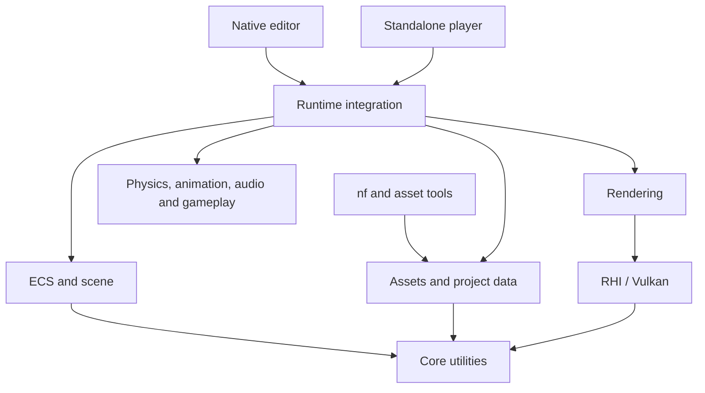

# Architecture

[Documentation](README.md) · [Complete design](SANAD_Engine_Complete_Design.md) · [Build and test](Build_and_Test.md)

SANAD is a **native C++23 engine**. The editor and standalone player use the same runtime, project format, asset pipeline and Vulkan rendering backend.

## Module boundaries

This diagram describes integration, not every CMake target. `Runtime` binds scene data to rendering and simulation. **Assets does not depend on Rendering/RHI; Rendering does not depend on ECS/Scene.** The [layering check](../Scripts/check_layering.sh) enforces those boundaries.

## Projects and assets

| Data | Role |
|:---|:---|
| `.nfproj` | Project metadata, logical mounts and startup scene |
| `.nfscene` | Authored entities and components |
| `.nfmat` | Material parameters |
| Lua scripts | Gameplay behavior through the scripting API |
| `Cache/` | Generated cooked assets |
| `dist/` | Generated standalone package |

Logical paths such as `content://Scenes/Main.nfscene` resolve through the project's mounts. The CLI and editor use the same data rather than separate browser or editor-only game formats.

## Editor command path

Widgets collect edits and call the validated `EditorApp` operations. Commands support undo/redo; transient input gestures are folded into a meaningful editing operation. Scene identity and edit revisions refresh UI drafts after scene replacement or command history changes.

Device-free editor logic is in `NFEditorCore`; the native shell owns windowing, docking and rendering. See [Editor guide](Editor_Guide.md) for user workflows.

## References

- [Scene systems](Reference/Scene_Systems.md): authored component behavior.
- [Asset import](Asset_Import.md): source assets and the cooked pipeline.
- [GPU profiling](GPU_Profiling.md) and [frame pacing](Frame_Pacing.md): measurements and their limits.
- [Complete design](SANAD_Engine_Complete_Design.md): long-form reference with stable section numbers used by source comments. Design intent does not imply every subsystem is integrated into every game path.
- [Development history](Archive/Development_History.md): historical milestone records.
