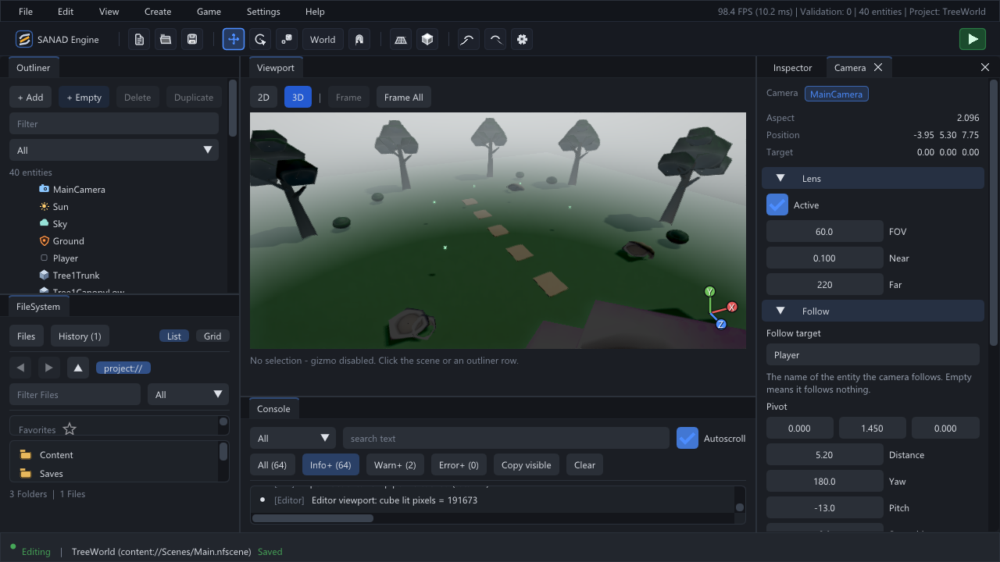
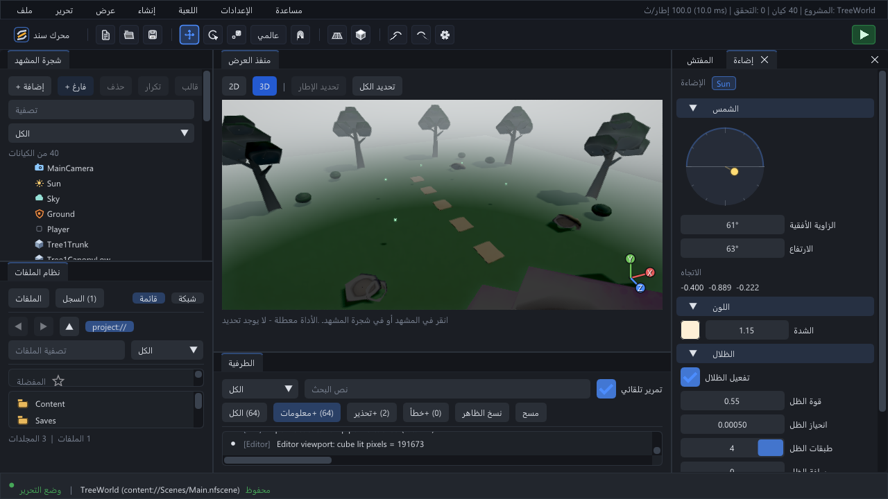
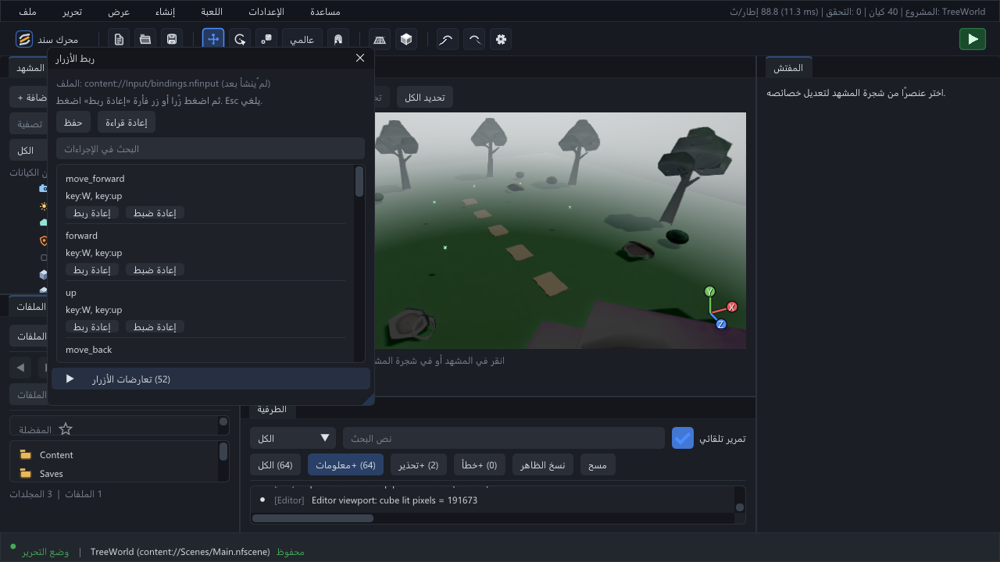

# Editor guide / دليل المحرر

[Documentation](README.md) · [Getting started](Getting_Started.md) · [Screenshots](Screenshots.md)

Applies to **0.8.0**. Screenshots show the TreeWorld example; the panel behavior is shared by other projects.

## Workspace

| Panel | Role |
|:---|:---|
| Outliner / شجرة المشهد | Selection, hierarchy and object creation |
| Viewport / منفذ العرض | Scene preview, selection, transform tools and camera navigation |
| Inspector / المفتش | Components on the selected entity |
| FileSystem / نظام الملفات | Assets, folders, filters, favourites and navigation history |
| Console / الطرفية | Searchable messages, severity filters and clipboard export |

Use **View** to open the Camera, Lighting, Environment, Input and diagnostic panels. Opening a docked panel selects its tab. Drag tabs and splitters to arrange the workspace; **View → Reset layout** restores the built-in arrangement.

## Edit safely

Select an object, choose translate/rotate/scale with `W` / `E` / `R`, and edit through the viewport or Inspector. Save with `Ctrl+S`. Undo and redo use `Ctrl+Z` / `Ctrl+Y`; duplication uses `Ctrl+D`.

The close/switch prompt handles unsaved changes. Choose Save, Discard or Cancel deliberately. A recovery file complements normal saving; it is not a version-control system.

## Navigate the viewport

Hold the right mouse button over the viewport to look and move with the navigation keys shown by the editor. `Home` frames the selection; `Shift+Home` frames the scene. These viewport shortcuts are suppressed while text fields or popups own the interaction.

Open **Help → Shortcuts** (`F1`) for the current shortcut reference.

## Camera

The Camera panel edits the active scene camera, falling back to the first camera if none is active. Lens controls edit FOV and clipping planes. The follow section names a target entity and controls pivot, distance, yaw, pitch and smoothing.

Unapplied fields are drafts. Scene replacement and undo/redo refresh them from scene data. Apply changes before switching to another authoring operation.

## Lighting and shadows

Use the sun dial or angle controls to set direction, then adjust colour, intensity and shadow parameters. **Apply** records the light change through the editor command path. Shadow drafts in Settings remain editable until Apply.

## Rebind controls

1. Open the Input panel and search for the action.
2. Choose **Rebind / إعادة ربط**.
3. Press a key, or click the dedicated mouse capture area.
4. Use Cancel or Escape to preserve the existing binding.
5. Save the bindings file when ready.

The opening click and clicks outside the mouse capture area are not bindings. Expand the conflict section to inspect shared controls. Some defaults intentionally share keys across different action lists or contexts.

## File browser

Use the root selector to browse `content://` or `project://`. Empty folders are visible; filtering files does not remove the folder hierarchy. Back/forward and favourites follow the selected mount. Right-click a file for supported open, rename and delete actions.

Asset deletion uses an explicit confirmation. Rename and delete failures are reported in the console; correct the input rather than editing generated `Cache/` files.

## Read the console

The severity buttons are **minimum-level filters**: Warn+ includes warnings and errors; Error+ includes Error and Fatal. Text/category queries combine with that level filter.

Autoscroll follows the tail while you are already there. Scroll upward to read older messages without being forced back down. **Copy visible** exports the active query with level/category tags; a message's context menu copies that message in logical UTF-8.

## بالعربية

ابدأ من شجرة المشهد لتحديد العنصر، وعدّل مكوناته من المفتش. اللوحات المتخصصة تفتح من **عرض**، والاختصارات الكاملة من **مساعدة**. احفظ التعديلات قبل الانتقال لعملية تأليف أخرى. عند فشل إجراء، راجع الطرفية وانسخ الرسالة كاملة، ثم استخدم [دليل الدعم](../SUPPORT.md) للإبلاغ عنها.
