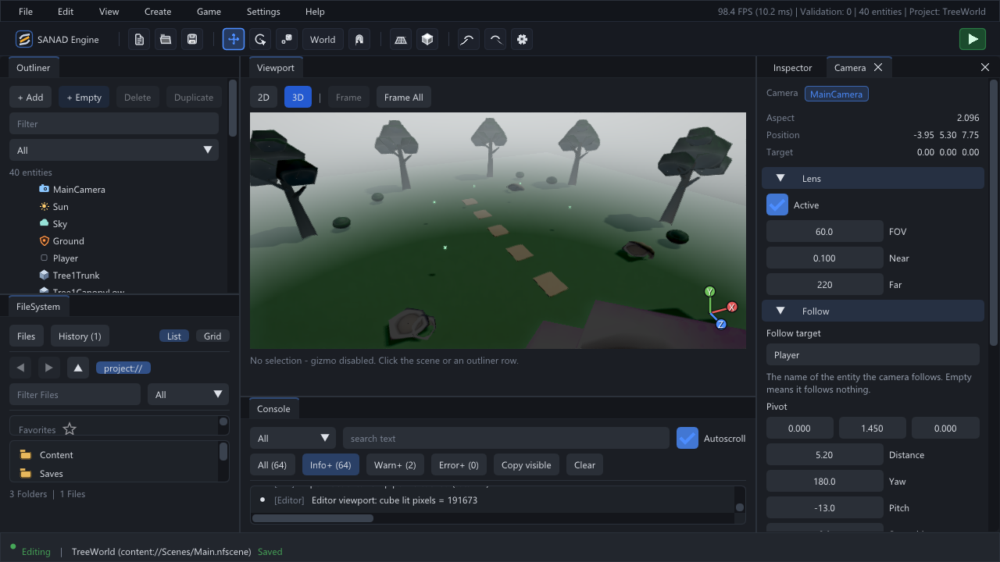
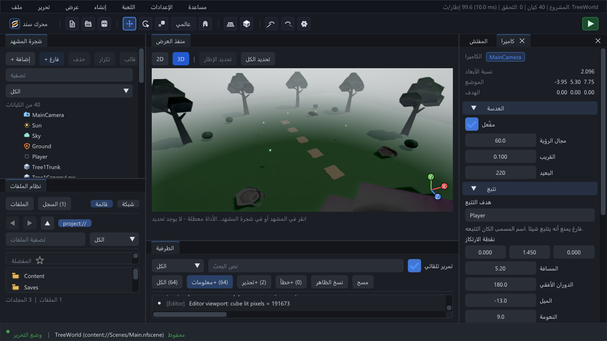
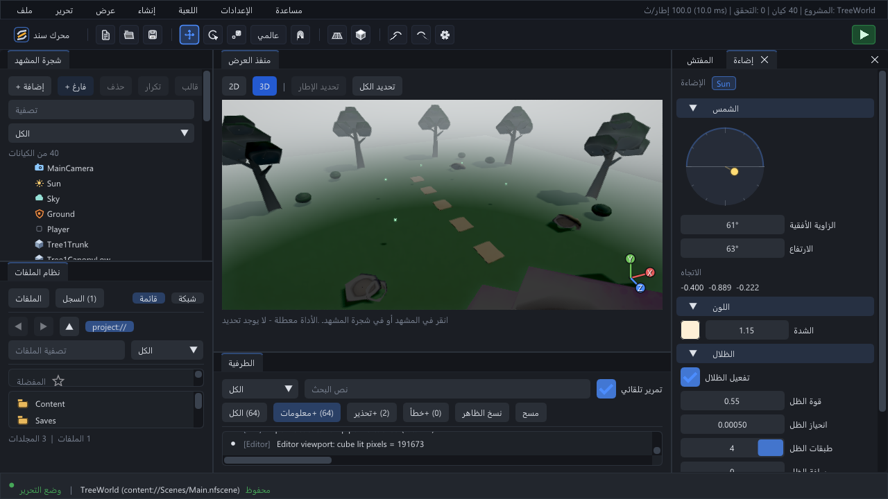
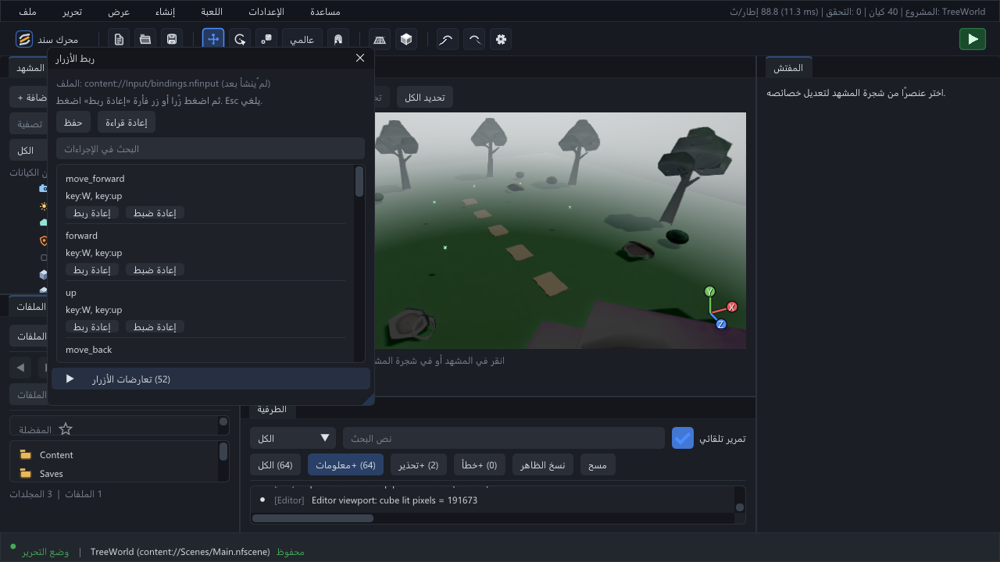

# Screenshots / معرض الواجهة

[Documentation](README.md) · [Editor guide](Editor_Guide.md) · [Capture policy](media/README.md)

These are **native SANAD 0.8.0 captures**, recorded on Windows on **2026-11-05**. They show the current editor, not UI mockups. The scene in the first four images is the TreeWorld sample source. Screenshot content is illustrative; it is not a performance benchmark.

## English workspace

## الواجهة العربية

## Lighting / الإضاءة

## Input / ربط الأزرار

The additional `shot_game.png` and `shot_vehicle.png` files are current project/scene captures kept for the launcher's thumbnail contract. Repeated website copies, development crops and the older demo GIF/video are no longer part of the main documentation tree; historical versions remain in Git history and release tags.
