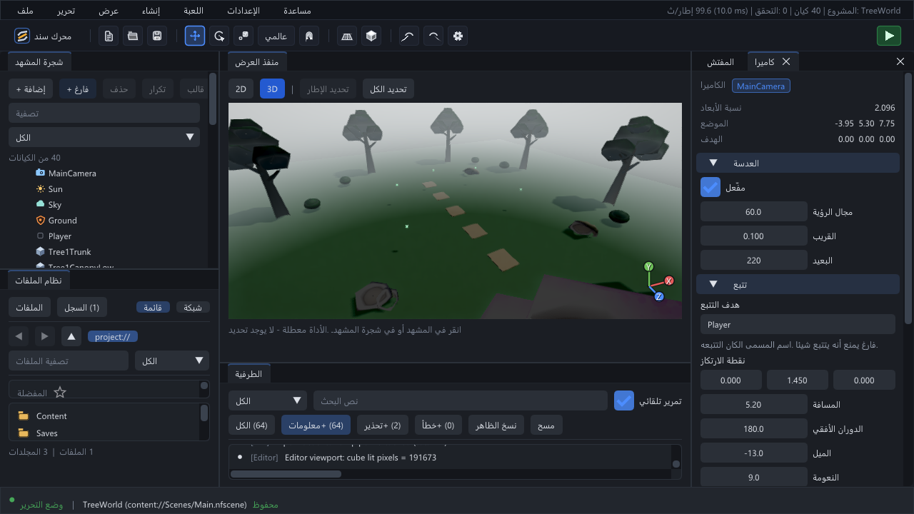

# من مشروع جديد إلى لعبة مستقلة

[التوثيق](README.md) · [البدء السريع](Getting_Started_Ar.md) · [دليل المحرر](Editor_Guide.md)

درس عملي للإصدار **0.8.0**: إنشاء مشروع، تعديل مشهده، تشغيله وبناء مجلد يمكن مشاركته. الصور الحديثة للواجهة في [المعرض](Screenshots.md).

## قبل البدء

نزّل النسخة المحمولة من [صفحة الإصدار](https://github.com/abdallah2183/SANAD-Engine/releases/tag/v0.8.0) وفك الضغط. تحتاج Windows x64 وتعريفًا رسوميًا يدعم Vulkan. لا تحتاج Visual Studio لاستخدام الحزمة المحمولة.

## إنشاء المشروع

1. شغّل `SANADEditor.exe` من مجلد الحزمة.
2. اختر **إنشاء مشروع جديد**.
3. اختر **ThirdPerson**، واسمًا مثل `MyFirstGame`، ومجلدًا قابلًا للكتابة.
4. أنشئ المشروع وانتظر فتح مشهد البداية.

لا تعدّل الملفات داخل مجلد تثبيت المحرك لتصنع لعبتك؛ ملفات المشروع موجودة في المجلد الذي اخترته.

## فهم الواجهة



هذه اللقطة توضح ترتيب اللوحات؛ محتوى مشروع ThirdPerson يختلف عن مشهد TreeWorld الظاهر فيها.

| اللوحة | الاستخدام |
|:---|:---|
| شجرة المشهد | اختيار العناصر وتنظيمها وإنشاؤها |
| منفذ العرض | رؤية المشهد والتحريك والتنقل بالكاميرا |
| المفتش | تعديل مكونات العنصر المحدد |
| نظام الملفات | استعراض المشاهد والمواد والسكربتات والمجلدات |
| الطرفية | قراءة الرسائل والبحث ونسخ التشخيصات |

افتح اللوحات المتخصصة من قائمة **عرض**، مثل الكاميرا والإضاءة وربط الأزرار.

## تعديل عنصر

اختر عنصرًا من شجرة المشهد. غيّر إحدى قيم موضعه في المفتش، ثم راقب منفذ العرض. جرّب التراجع والإعادة، واحفظ بـ`Ctrl+S`.

| الاختصار | الوظيفة |
|:---|:---|
| `W` / `E` / `R` | نقل / دوران / تحجيم |
| `Ctrl+S` | حفظ |
| `Ctrl+Z` / `Ctrl+Y` | تراجع / إعادة |
| `Ctrl+D` | تكرار التحديد |
| `Delete` | حذف التحديد مع إمكانية التراجع |
| `Home` / `Shift+Home` | تأطير التحديد / المشهد من منفذ العرض |
| `F1` | عرض مرجع الاختصارات |

الأوامر لا تنفّذ اختصارات المشهد أثناء الكتابة داخل حقل نصي. راجع **مساعدة ← الاختصارات** للأوامر الإضافية.

## تجربة اللعب

اضغط زر **تشغيل**. يستخدم قالب ThirdPerson أزرار `WASD` أو الأسهم للحركة و`Space` للقفز. أغلق نافذة اللاعب لإنهاء التجربة. لتغيير التحكم، افتح لوحة ربط الأزرار، وابحث عن الإجراء ثم اختر إعادة الربط.

التعديلات على البنية أثناء تشغيل المحاكاة قد تكون معطلة. أوقف اللعب قبل إضافة المكونات أو حذفها.

## تعديل سكربت

افتح `Content/Scripts/player.lua` في مشروع ThirdPerson. ابدأ بتغيير قيمة سرعة الحركة الموجودة فيه، ثم احفظ وجرب التشغيل من جديد. لا تنشئ سكربتًا بديلًا كاملًا قبل فهم المثال.

داخل سكربت مرتبط بكيان، تستدعي البيئة `update(dt)` كل إطار. المثال التالي يوضح قراءة الموضع والتحريك بسرعة مستقلة عن معدل الإطارات:

```lua
function update(dt)
    local x, y, z = nf.entity_pos(self_id, self_gen)
    if x then
        nf.set_entity_pos(self_id, self_gen, x + dt, y, z)
    end
end
```

هذا مثال منفصل للتعلم؛ لا تلصقه فوق سكربت اللاعب كاملًا. مرجع الدوال في [دليل Lua](Lua_Scripting_Ar.md).

## بناء نسخة مستقلة

من مجلد الحزمة، استخدم مسار ملف مشروعك:

```bat
nf.exe build --project "C:\Projects\MyFirstGame\MyFirstGame.nfproj"
```

ثم شغّل `NFPlayer.exe` داخل مجلد `dist` الناتج، أو مرّر ملف المشروع المعبّأ صراحة:

```bat
"C:\Projects\MyFirstGame\dist\NFPlayer.exe" --project "C:\Projects\MyFirstGame\dist\MyFirstGame.nfproj"
```

تحقق قبل المشاركة:

```bat
nf.exe run --project "C:\Projects\MyFirstGame\MyFirstGame.nfproj" --frames 120 --headless --validation
```

شارك مجلد `dist` كاملًا بعد نجاح الأمر وظهور `Validation errors: 0`.

## أين تتابع؟

[دليل المحرر](Editor_Guide.md) · [استيراد النماذج](Asset_Import.md) · [Blender](Blender_Pipeline.md) · [الدعم وحل المشكلات](../SUPPORT.md)
