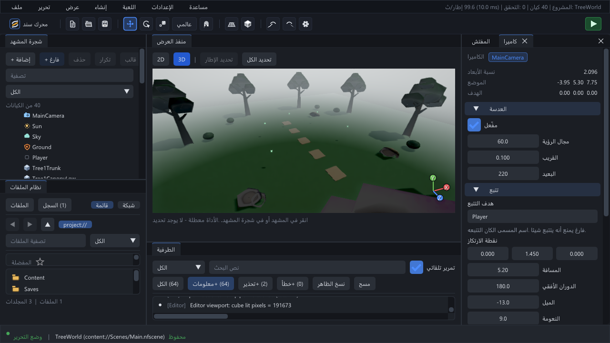

<div align="center">


# محرك سَنَد

### محرك ألعاب أصلي، ومحرر عربي من البداية.

C++23 · Vulkan · Windows x64 · Apache-2.0

[](https://github.com/abdallah2183/SANAD-Engine/releases/tag/v0.9.0)
[](Docs/Getting_Started_Ar.md#المتطلبات)
[](LICENSE)

**[تنزيل 0.9.0](https://github.com/abdallah2183/SANAD-Engine/releases/tag/v0.9.0)** · **[ابدأ هنا](Docs/Getting_Started_Ar.md)** · **[التوثيق](Docs/README.md)** · **[English](README.md)**



<sub>لقطة فعلية من سَنَد 0.8.0 على Windows، والمشهد من مثال TreeWorld.</sub>

</div>

## نبذة

يجمع سَنَد بيئة تشغيل مكتوبة بلغة C++، وعارض Vulkan، ومحرر مشاهد لسطح المكتب. أنشئ مشروعًا، وعدّل المشهد وسكربتات Lua، ثم ابنِ لاعبًا مستقلًا لويندوز باستخدام أدوات المحرك نفسها.

المحرر يدعم العربية والإنجليزية، مع تشكيل النص العربي، ومشغّل مشاريع، ولوحات قابلة للإرساء، وشجرة مشهد، ومفتش خصائص ومتصفح أصول.

## اختر مسارك

| ما تريد إنجازه | الدليل |
|:---|:---|
| تجربة المحرك | [تنزيل النسخة المحمولة](https://github.com/abdallah2183/SANAD-Engine/releases/tag/v0.9.0) |
| إنشاء أول مشروع | [البدء السريع](Docs/Getting_Started_Ar.md) · [الدرس العملي](Docs/Tutorial_Ar.md) |
| تعلّم الواجهة | [دليل المحرر](Docs/Editor_Guide.md) |
| بناء المحرك من المصدر | [البناء والاختبارات](Docs/Build_and_Test.md) |
| كتابة منطق اللعب | [مرجع Lua](Docs/Lua_Scripting_Ar.md) · [دليل الوكلاء](Docs/AI_Game_Guide.md) |
| الإبلاغ عن مشكلة | [الدعم](SUPPORT.md) · [المشكلات](https://github.com/abdallah2183/SANAD-Engine/issues) |

## البدء السريع

1. نزّل [`SANAD-0.9.0-Windows-x64-Portable.zip`](https://github.com/abdallah2183/SANAD-Engine/releases/download/v0.9.0/SANAD-0.9.0-Windows-x64-Portable.zip).
2. فك الضغط وشغّل `SANADEditor.exe`.
3. أنشئ مشروعًا من قالب **ThirdPerson**، ثم اضغط **تشغيل**.

أو استخدم الطرفية من مجلد المحرك بعد فك الضغط:

```bat
nf.exe new MyGame --name MyGame --template ThirdPerson
nf.exe build --project MyGame\MyGame.nfproj
MyGame\dist\NFPlayer.exe --project MyGame\dist\MyGame.nfproj
```

**المتطلبات:** Windows 10 أو 11 بنواة x64، وتعريف رسومي يدعم Vulkan. الإصدار محمول بلا مثبّت، ومعه [بصمة SHA-256](https://github.com/abdallah2183/SANAD-Engine/releases/download/v0.9.0/SHA256SUMS.txt). الملفات التنفيذية تحمل شهادة تطوير ذاتية، وليست شهادة توقيع عامة موثوقة من Windows.

## ما الذي يتضمنه؟

| المجال | المكونات |
|:---|:---|
| المحرر | واجهة عربية وإنجليزية، إرساء اللوحات، شجرة مشهد، مفتش، أدوات تحويل، تراجع وإعادة، قوالب مسبقة، استيراد وتصدير وسجل قابل للبحث |
| العرض | Vulkan، رسم بياني لممرات العرض، مواد PBR، ظلال وسماء ومعالجة لاحقة وقياس زمن GPU |
| المحاكاة | ECS ومشاهد، فيزياء Jolt ثلاثية الأبعاد، دعم مشاهد ثنائية الأبعاد، تحريك وصوت وتنقل |
| اللعب | Lua، ربط الأزرار، التحكم بالكاميرا، ومكوّنات قتال وذكاء اصطناعي قابلة للتأليف بالبيانات |
| الأدوات | قوالب مشاريع، أداة `nf`، طبخ الأصول، استيراد النماذج وحزم اللاعب المستقل |

التفاصيل في [المعمارية](Docs/Architecture.md) و[مرجع أنظمة المشهد](Docs/Reference/Scene_Systems.ar.md).

## جديد 0.9.0

- معاينة أندرويد تجريبية بصيغة APK، مع اللمس المتعدد والصوت وقالب منصات 2.5D.
- تصدير ألعاب ويندوز إلى ملف EXE واحد، وتشغيل المحرر دون نافذة أوامر.
- واجهة لعب مبرمجة بـLua (`nf.ui`): تخطيط مثبّت، حقول نص وأرقام، قوائم، تلميحات وتنقل بلوحة المفاتيح، مع معاينة حية في نافذة اللعب داخل المحرر.
- إعدادات لكل مشروع (`nf.settings`)، وتنقل بين المشاهد من Lua، وقالب `UiStarter` جديد.
- المحرر: منتقي مكوّنات ثنائي اللغة، مسودات Apply/Revert لمكوّنات 2D، بحث وفلاتر في Outliner والمفتش، وإيقاف مؤقت حقيقي.
- إصلاحات Vulkan لأجهزة أندرويد وتحسينات للصوت والإدخال.

[ملاحظات الإصدار](Docs/Releases/0.9.0.md) · [سجل الإصدارات](CHANGELOG.md) · [معرض الواجهة](Docs/Screenshots.md)

## البناء من المصدر

ثبّت Visual Studio مع أدوات C++ لسطح المكتب، وCMake وNinja وVulkan SDK، ثم:

```bat
git clone https://github.com/abdallah2183/SANAD-Engine.git
cd SANAD-Engine
build_nf.bat Release
build\Release\bin\SANADEditor.exe
```

يكتشف السكربت أدوات MSVC ويبني المحرر والأدوات والأمثلة والاختبارات. راجع [دليل البناء](Docs/Build_and_Test.md) للمتطلبات وأوامر التحقق والتغليف.

## التحقق من الإصدار

آخر تحقق كامل مسجّل (للإصدار 0.8.0) ببناء Release على Windows x64:

| الفحص | النتيجة المسجلة |
|:---|:---|
| الاختبارات الآلية | 26 حزمة؛ 2828 ناجحًا، بلا إخفاقات، و3 اختبارات متخطاة |
| اختبار المحرر | 180 إطارًا؛ نجاح الأتمتة وصفر أخطاء تحقق Vulkan |
| الحزمة المحمولة | فك الضغط خارج المستودع، ثم إنشاء مشروع وبناؤه وتشغيل اللاعب والمحرر العربي |

هذه نتائج الإصدار المنشور، وليست شارة لحالة CI الحالية. أسباب التخطي وحدود الفحص موثقة في [ملاحظات الإصدار](Docs/Releases/0.8.0.md#verification--التحقق).

## تنظيم المستودع

```text
Engine/       أنظمة المحرك وبيئة التشغيل
Editor/       المحرر ومشغّل المشاريع
Tools/        أدوات الطرفية والأصول واللاعب
Templates/    قوالب المشاريع وتكامل Blender
Games/        مشاريع الألعاب التجريبية
Samples/      أمثلة مركزة للأنظمة
Tests/        الاختبارات الآلية
Docs/         أدلة ومراجع وإصدارات وأرشيف
packaging/    أدوات حزم Windows
```

## المساهمة والترخيص

ابدأ من [دليل المساهمة](CONTRIBUTING.md). نرحب بتحسينات C++ والتوثيق والأمثلة وتجربة الاستخدام العربية.

[خارطة الطريق](ROADMAP.md) · [الأمان](SECURITY.md) · [قواعد السلوك](CODE_OF_CONDUCT.md)

المحرك بترخيص [Apache-2.0](LICENSE). تراخيص المكتبات الخارجية محفوظة معها، والخط العربي [Amiri بترخيص SIL Open Font License](Resources/fonts/FONTS.md).

يدير المشروع [عبدالله](https://github.com/abdallah2183).
