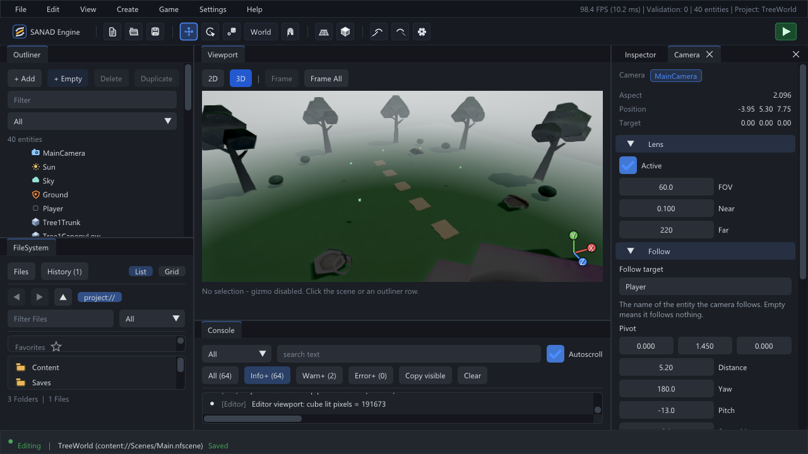

<div align="center">


# SANAD Engine

### A native game engine. An Arabic-first editor.

C++23 · Vulkan · Windows x64 · Apache-2.0

[](https://github.com/abdallah2183/SANAD-Engine/releases/tag/v0.9.0)
[](Docs/Getting_Started.md#requirements)
[](LICENSE)

**[Download 0.9.0](https://github.com/abdallah2183/SANAD-Engine/releases/tag/v0.9.0)** · **[Get started](Docs/Getting_Started.md)** · **[Documentation](Docs/README.md)** · **[العربية](README.ar.md)**



<sub>Captured from SANAD 0.8.0 on Windows. The scene is the TreeWorld sample.</sub>

</div>

## Overview

SANAD combines a native C++ runtime, a Vulkan renderer and a desktop scene editor. Create a project, edit its scene and Lua scripts, then package a standalone Windows player using the same `nf` toolchain.

The editor supports Arabic and English, including shaped Arabic text, a project launcher, docked panels, scene hierarchy, component inspection and asset browsing.

## Start here

| I want to… | Go to |
|:---|:---|
| Try the engine | [Download the portable release](https://github.com/abdallah2183/SANAD-Engine/releases/tag/v0.9.0) |
| Make my first project | [Getting started](Docs/Getting_Started.md) · [الدليل العربي](Docs/Getting_Started_Ar.md) |
| Learn the editor | [Editor guide](Docs/Editor_Guide.md) |
| Build the engine | [Build and test](Docs/Build_and_Test.md) |
| Write gameplay | [Lua reference](Docs/Lua_Scripting_Ar.md) · [AI agent workflow](Docs/AI_Game_Guide.md) |
| Report a problem | [Support](SUPPORT.md) · [Issue tracker](https://github.com/abdallah2183/SANAD-Engine/issues) |

## Quick start

1. Download [`SANAD-0.9.0-Windows-x64-Portable.zip`](https://github.com/abdallah2183/SANAD-Engine/releases/download/v0.9.0/SANAD-0.9.0-Windows-x64-Portable.zip).
2. Extract it and run `SANADEditor.exe`.
3. Create a project using **ThirdPerson**, then press **Play**.

Or use the CLI from the extracted engine folder:

```bat
nf.exe new MyGame --name MyGame --template ThirdPerson
nf.exe build --project MyGame\MyGame.nfproj
MyGame\dist\NFPlayer.exe --project MyGame\dist\MyGame.nfproj
```

**Requirements:** Windows 10/11 x64 and a Vulkan-capable graphics driver. The release is a portable ZIP, with a [SHA-256 checksum](https://github.com/abdallah2183/SANAD-Engine/releases/download/v0.9.0/SHA256SUMS.txt). Its executables use a self-signed development certificate; this is not a publicly trusted Windows signing certificate.

## Capabilities

| Area | Included |
|:---|:---|
| Editor | Arabic/English UI, docking, hierarchy, inspector, transform tools, undo/redo, prefab workflows, import/export and searchable logs |
| Rendering | Vulkan RHI, render graph, PBR materials, shadows, sky, post-processing and GPU profiling |
| Simulation | ECS and scene systems, Jolt 3D physics, 2D scene support, animation, audio and navigation |
| Gameplay | Lua scripting, input bindings, camera controls and data-driven combat/AI components |
| Toolchain | Project templates, `nf` CLI, asset cooker, model importer and standalone player packaging |

See the [architecture](Docs/Architecture.md) and [scene systems reference](Docs/Reference/Scene_Systems.md) for implementation details and scope.

## What's new in 0.9.0

- Experimental Android preview (APK) with multi-touch, audio and a 2.5D platformer template.
- Windows games export to a single EXE; the editor starts without a console window.
- Scripted runtime UI (`nf.ui`): anchored layout, text/number input, lists, tooltips and keyboard navigation, previewed live in the editor Game View.
- Per-project settings (`nf.settings`), Lua scene flow (load/restart/quit) and a new `UiStarter` template.
- Editor: bilingual component picker, 2D Inspector drafts with Apply/Revert, Outliner and Inspector search/filters, true Pause.
- Vulkan fixes for Android devices plus audio and input improvements.

[Full release notes](Docs/Releases/0.9.0.md) · [Changelog](CHANGELOG.md) · [Screenshots](Docs/Screenshots.md)

## Build from source

Install Visual Studio with the C++ desktop workload, CMake, Ninja and the Vulkan SDK. Then:

```bat
git clone https://github.com/abdallah2183/SANAD-Engine.git
cd SANAD-Engine
build_nf.bat Release
build\Release\bin\SANADEditor.exe
```

The script discovers the MSVC toolchain and builds the editor, tools, samples and tests. See [build and test](Docs/Build_and_Test.md) for prerequisites, verification commands and packaging.

## Verification

The last full release verification (recorded for 0.8.0) used a Release build on Windows x64:

| Check | Recorded result |
|:---|:---|
| Automated suites | 26 suites; 2,828 passed, 0 failed, 3 skipped |
| Editor acceptance | 180 frames; automation passed; 0 Vulkan validation errors |
| Portable package | Extracted outside the checkout; project creation, build, player and Arabic editor verified |

These are release results, not a live CI badge. Skip reasons and scope are recorded in the [release notes](Docs/Releases/0.8.0.md#verification--التحقق).

## Repository map

```text
Engine/       Runtime modules and subsystems
Editor/       Native editor and project launcher
Tools/        CLI, asset pipeline and standalone player
Templates/    Project starters and Blender integration
Games/        Sample game projects
Samples/      Focused native demonstrations
Tests/        Automated test suites
Docs/         Guides, references, releases and historical archive
packaging/    Windows portable/installer tooling
```

## Contribute

Read [CONTRIBUTING.md](CONTRIBUTING.md), choose a focused change and include the verification that supports it. Documentation, samples, C++ systems and Arabic UX improvements are welcome.

[Roadmap](ROADMAP.md) · [Security](SECURITY.md) · [Code of conduct](CODE_OF_CONDUCT.md)

## License

SANAD is licensed under [Apache-2.0](LICENSE). Third-party notices remain with the vendored dependencies. The Arabic editor font is [Amiri, under the SIL Open Font License](Resources/fonts/FONTS.md).

Maintained by [Abdallah](https://github.com/abdallah2183).
