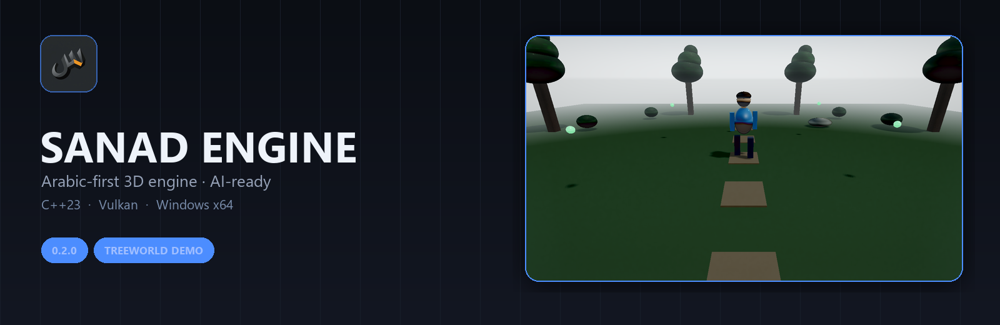
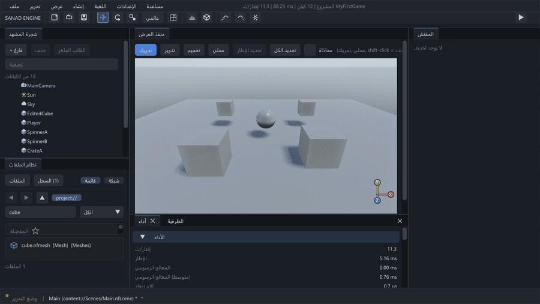
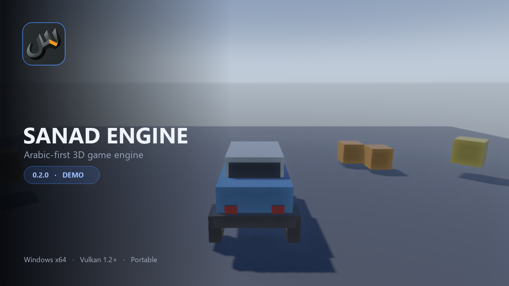
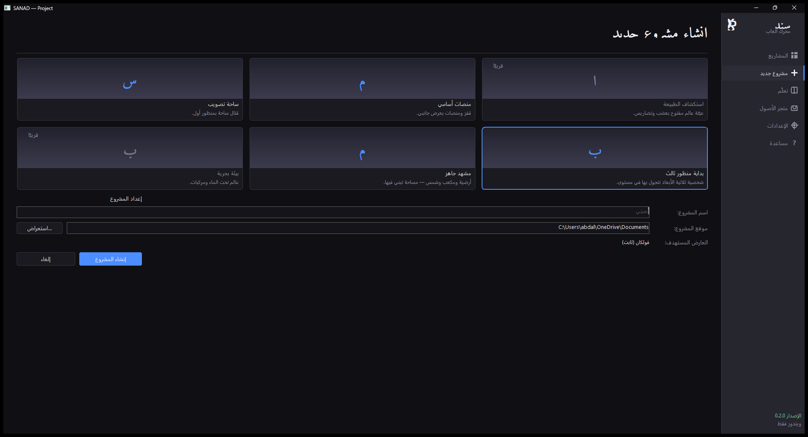
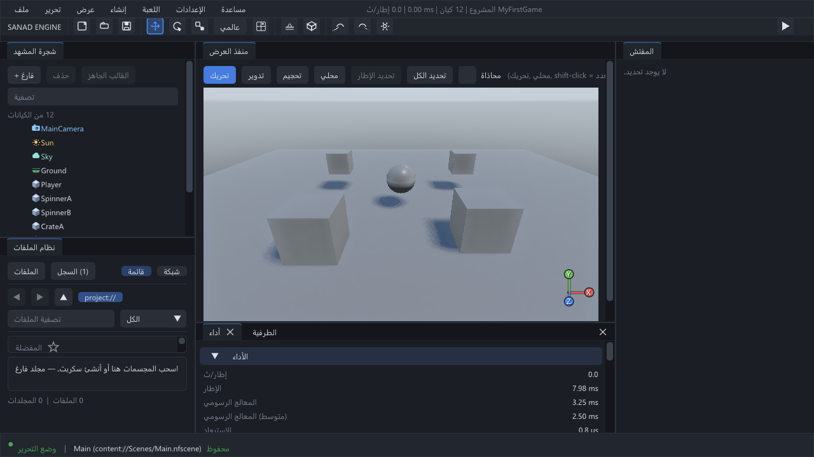
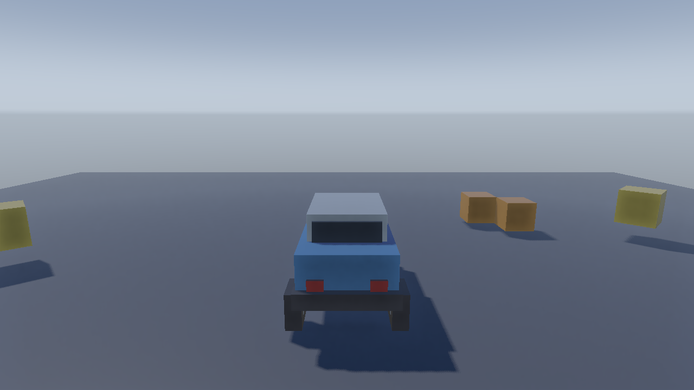
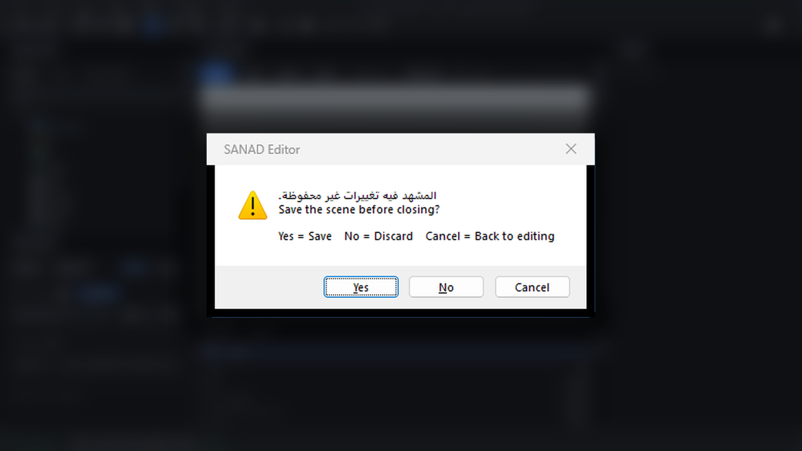
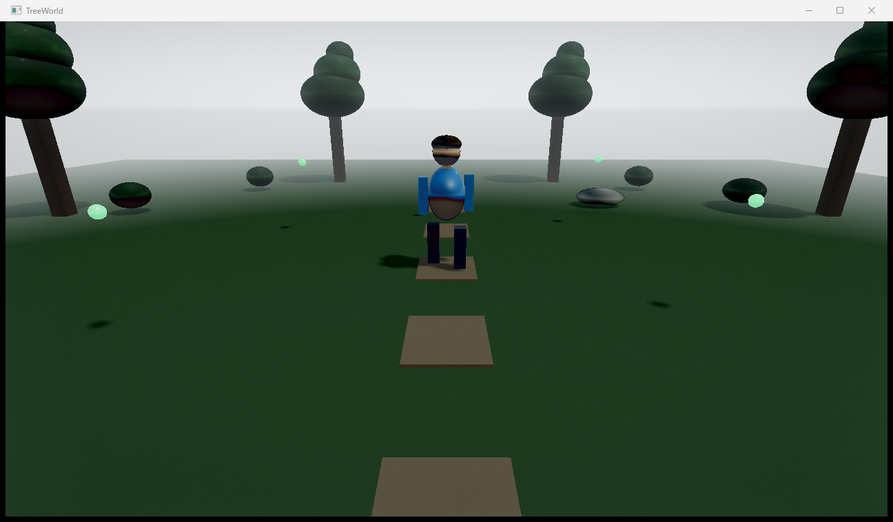
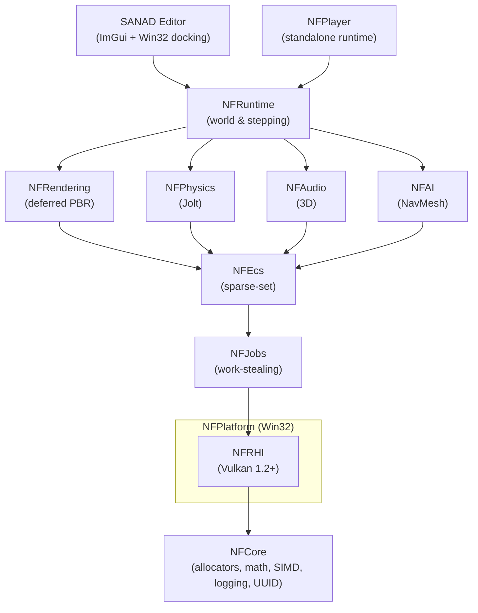

<div align="center">



# SANAD Engine · محرك سَنَد

**A modern C++23 + Vulkan 3D game engine — with an Arabic-first editor.**
<br>
محرك ألعاب ثلاثي الأبعاد مكتوب بـ C++23 وVulkan — ومحرر يتكلم العربية من أول يوم.

<a href="https://github.com/abdallah2183/SANAD-Engine/releases/latest"></a>
<a href="LICENSE"></a>
<a href="#"></a>
<a href="#"></a>
<a href="#"></a>
<a href="#"></a>
<a href="AGENTS.md"></a>
<a href="CONTRIBUTING.md"></a>

<br>

[**What's new in 0.6.0**](RELEASE_NOTES_0.6.0.md) ·
[**Download 0.6.0**](https://github.com/abdallah2183/SANAD-Engine/releases/tag/v0.6.0) ·
[**Watch the 43s demo**](Docs/media/demo.mp4) ·
[**Docs**](Docs/) ·
[**العربية**](README.ar.md)

<br>



</div>

---

> [!IMPORTANT]
> **0.6.0 is a public release, not a beta.** It ships as a **portable Windows x64
> zip** built from this tree, with a SHA-256 checksum. The executables are signed
> with the self-signed **`SANAD Dev Build`** certificate, not a publicly trusted
> one, so Windows may still show "Unknown publisher". Do not disable Smart App
> Control or WDAC to run it — check the signature/policy warning instead. A
> Vulkan-capable GPU driver is required.

## 🌟 Why SANAD?

- **Arabic-first, not Arabic-later.** The editor ships a UCD-verified Arabic text
  shaper (contextual forms, lam-alef ligatures, full bidi), the Amiri font, and a
  complete English/Arabic UI. The launcher, editor, guide, and save prompts are all
  usable in Arabic.
- **A real editor, not a demo shell.** Docking layout, scene outliner, reflected
  inspector, translate/rotate/scale gizmos, undo/redo, asset browser, hot reload,
  and a **Start Here** guide that gets a new user to a playable scene.
- **Built like an engine.** C++23, a Vulkan 1.2+ RHI, a data-oriented sparse-set
  ECS, a DAG RenderGraph, and strict module layering enforced in CI.
- **AI-ready, not AI-washed.** The repo, the CLI, and every generated project
  carry the same executable contract, so an agent makes a native `.nfproj`
  instead of drifting into a web stub.
- **End-to-end workflow.** Create a project, add objects, press **Play**, save with
  a close guard and recovery copy, then package a standalone player.
- **Open source.** Apache-2.0 — use it, learn from it, or build on it.

## 🚀 Quick start

### 1. Download

Grab the portable build from the [0.6.0 release](https://github.com/abdallah2183/SANAD-Engine/releases/tag/v0.6.0):

| File | What to do |
|:---|:---|
| [`SANAD-0.6.0-Windows-x64-Portable.zip`](https://github.com/abdallah2183/SANAD-Engine/releases/download/v0.6.0/SANAD-0.6.0-Windows-x64-Portable.zip) | Extract anywhere → run `SANADEditor.exe` |
| [`SHA256SUMS.txt`](https://github.com/abdallah2183/SANAD-Engine/releases/download/v0.6.0/SHA256SUMS.txt) | SHA-256 checksum for the portable zip |

> [!NOTE]
> There is **no installer in this release yet**. The portable zip carries a
> self-signed development signature, so Windows may show "Unknown publisher" on a
> machine that does not trust that certificate. The release is Windows 10/11 x64
> only.

> [!TIP]
> **Create Project says "Access is denied (code 5)"?** Windows stamps files
> extracted from a downloaded ZIP with a *Low integrity* label, and a process at
> that level cannot write to Desktop, Documents, or OneDrive. Double-click
> `FixPermissions.cmd` once from the engine folder (no administrator rights
> needed), then reopen the editor. `RunEditor.cmd` also repairs the label on the
> binaries each time it launches them.

### 2. Make something in 30 seconds

1. `SANADEditor.exe` → **Create New Project**
2. Pick **Third-Person**, name it, press **Create**
3. The scene opens with a Start Here guide → press **Play** (or `Ctrl+P`)

### 3. Or use the CLI

```bat
nf.exe new MyGame --name MyGame --template ThirdPerson
nf.exe build --project MyGame\MyGame.nfproj
cd MyGame\dist && NFPlayer.exe
```

## 🤖 Using an AI coding agent

SANAD is built to be driven by an agent, not replaced by a web toy. If you point
Claude Code, Codex, Cursor, or another coding agent at this repository:

- It reads [`AGENTS.md`](AGENTS.md) automatically; `CLAUDE.md`, `.cursor/rules/`,
  and `llms.txt` are entry points for the common tools.
- `nf guide` prints the same hard rule and workflow in the terminal.
- Every project created by `nf new` gets its own `AGENTS.md`, so an agent opened
  in the **game folder** also knows what to do.
- The executable recipe is in [`Docs/AI_Game_Guide.md`](Docs/AI_Game_Guide.md):
  create a `.nfproj`, edit `.nfscene` + Lua, then `nf run`.

**The hard rule:** a SANAD game is a native `.nfproj` built with `nf` — never an
`index.html`, a web server, or a Unity/Godot project.

## 🎬 See it in action

[](Docs/media/demo.mp4)

*43 seconds, no voice-over: launcher → editor → build → Play → save guard → portable package.*

| Launcher (Arabic) | Editor (Arabic RTL) |
|:---:|:---:|
|  |  |

| Vehicle demo | Work protection |
|:---:|:---:|
|  |  |

## 🎮 Sample game: TreeWorld

A complete playable game built entirely from SANAD data — a rigged explorer
walking a misty forest, collecting five fireflies. Source, scene, Lua, materials,
and procedural textures live in [`Games/TreeWorld`](Games/TreeWorld); the style
is deliberately low-poly because the assets are authored as code (a rig with 19
bones and three clips, tapered trunks, jittered rocks) rather than bought from a
scanned forest pack.



```bat
build\Release\bin\nf.exe run --project Games\TreeWorld\TreeWorld.nfproj
```

> [!NOTE]
> TreeWorld ships **in the 0.6.0 portable zip** under `Games/`, and on
> **`main`** as source. `nf run --project Games\TreeWorld\TreeWorld.nfproj`
> builds and plays it from the repository; the packaged copy plays the same
> scene standalone.

## ✨ What's in 0.6.0

- **Combat feedback, from one scene line** — `Feedback: flash_time=0.06
  flash_size=0.26 tracer_time=0.1 tracer_length=7 tracer_width=0.03
  impact_time=8 impact_size=0.18 shot_volume=0.6 impact_volume=0.4` turns the
  shot and impact events the engine already publishes into a muzzle flash per
  volley, a tracer per pellet, and a projected scorch decal per surface hit.
- **No new GPU pass, no new asset** — flashes and tracers are render-only
  `RenderWorld` objects on one shared procedural cube; the scorch is a decal.
  The gunshot and impact are procedural one-shots, so a game does not need a WAV
  to hear its own gun.
- **Opt-in, byte-for-byte compatible** — a scene without the line draws and
  mixes exactly what it did in 0.5.0. The component round-trips through the real
  writer/reader, bad values are refused by key name, and the validator warns on
  out-of-range tuning.
- **Events land where the player can see them** — the director ingests the
  previous frame's events after `begin_frame()`, ages before ingest, and holds
  cues until a whole audio block is mixed, so the first shot of a fight is
  neither dropped nor inaudible.
- **`Ballistics.nfscene` demonstrates it** — the shipped scene opts in, so the
  projectile-vs-hitscan showcase now shows and hears the fight.
- **Everything from 0.5.0 remains** — FXAA on the tonemapped image, ADS, mouse
  buttons, camera shake and recoil, decals, render scale, dynamic resolution,
  master dynamics, and player settings.
- **Docs that match the build** — [release notes](RELEASE_NOTES_0.6.0.md),
  [demo notes](Docs/Demo_Release.md), and a five-minute quick start.

## 🔬 GPU profiling (development tree)

The development tree closes the RHI timing gap with **real Vulkan timestamp
queries**. It is deliberately opt-in for games: normal gameplay records no
timestamps and pays no per-frame profiling cost.

- **Editor:** profiling is on by default as a development tool. The Performance
  panel shows `GPU (timestamp)`, a decaying average, and one row per RenderGraph
  pass. On a device without timestamp support it falls back to the existing
  submit-to-fence estimate (`gpu_us`/`gpu_avg_us`).
- **Player:** pass `--gpu-timing` (or set `NF_PLAYER_GPU_TIMING=1`) to print the
  last completed frame and its per-pass breakdown at exit. Without it no report
  is printed; a scene that explicitly asks for GPU-aware dynamic resolution may
  still enable frame timestamps internally.
- **Dynamic resolution can use it:** `dynamic_resolution_timing=gpu` makes the
  frame-time governor consume real GPU frame time instead of CPU `dt`, with an
  automatic fallback to CPU when no fresh sample exists. It needs frame timing
  only — never the per-pass drains — and the cooldown stays on wall time.
- **Two independent renderer switches:** frame timestamps and per-pass
  timestamps. `Runtime::set_gpu_profiling_enabled(true)` enables both and
  re-applies the request after every renderer init; direct `Renderer3D` users
  can keep only the frame timing if per-pass drains are too intrusive.
- **Honest numbers:** results are sampled one in-flight slot late, so the first
  frame has no sample. Per-pass timing inserts a `BottomOfPipe` at each pass
  boundary, which serialises the GPU; a timed run is useful for attribution but
  is not a free measurement of an untimed frame. RenderGraph barriers stay
  outside each pass's duration.
- **Tests:** `RHITests` covers a real timestamped GPU transfer, availability
  polling, RenderGraph pass brackets, a three-frame `Renderer3D` integration
  run, and the governor's GPU-time/CPU-cooldown rules. `RuntimeTests` proves a
  scene enables frame timing without profiling and that a stale sample falls
  back to CPU. See [GPU profiling](Docs/GPU_Profiling.md) for the query layout,
  API, and limitations.

```bat
:: development capture; NFPlayer also accepts NF_PLAYER_GPU_TIMING=1
build\Release\bin\NFPlayer.exe --project Games\TreeWorld\TreeWorld.nfproj --gpu-timing
```

### Frame pacing (Phase 41)

The editor's Performance panel and `NFPlayer --frame-stats` report a rolling
120-frame window: average FPS, 1% low, frame-time jitter, and a CPU/GPU
bottleneck verdict. It measures raw wall time, so presentation/vsync waiting is
visible; add `--gpu-timing` for the GPU average and verdict. This is telemetry
only and is separate from DynamicResolution. See
[frame pacing](Docs/Frame_Pacing.md).

```bat
build\Release\bin\NFPlayer.exe --project Games\TreeWorld\TreeWorld.nfproj --frame-stats --gpu-timing
```

### Layered damage, blasts, shot events, statuses and combat memory (Phases 50-56)

The development tree turns one damage number into a layered hit. Hit zones are
opt-in per target (`Health: ... zones=true head=2 limb=0.75`), armor is a real
second pool (`armor=40 armor_max=40 absorb=0.6`), and a weapon's `pierce=` can
bypass part of it. Damage types (`damage_type=ballistic|explosive|fire`) meet
per-type resistance (`resist_fire=0.4`). The order is fixed and tested:
falloff, zone, resistance, armor, health. `nf.impact(i)` carries `zone`,
`armor_absorbed`, `damage_type` and `splash`.

A weapon can own a radial blast (`blast_radius=4 blast_damage=45
blast_min=0.2`). Damage falls linearly to the edge, distance is measured to the
nearest point of a box, walls block the blast, factions still apply, and the
direct victim is not hit twice. Every other victim gets its own `splash=true`
impact event.

`ShotEvent` is the other half: one event per pellet, with the muzzle origin,
the post-spread direction and the pellet index. `nf.shot_count()` /
`nf.shot(i)` let a game draw a muzzle flash or a tracer even when the shot
misses.

A hit can start a damage-over-time status (`status=burn status_dps=4
status_time=3 status_tick=0.5`). Burning, bleeding and corrosion tick at a fixed
cadence through the same resistance and armor path; a partial final tick pays
exactly what is left. `nf.apply_status()` / `nf.status_remaining()` /
`nf.clear_status()` expose it to Lua.

Combat memory survives the frame: a damage ledger records the last attacker,
totals and killer, and `retaliate=true` lets an agent prefer that attacker when
it is still a valid target. Near-miss shots build suppression, slowing the turn,
narrowing the fire cone and holding the trigger above 0.75. Lua reads it through
`nf.last_attacker()` / `nf.killer()` / `nf.damage_taken()` / `nf.suppression()`.
See [Combat_Damage.md](Docs/Combat_Damage.md).

```text
Health: max=100 health=100 armor=40 armor_max=40 absorb=0.6 zones=true head=2 limb=0.75 resist_explosive=0.2
Weapon: mode=semi rpm=60 magazine=1 damage=20 range=120
        delivery=projectile speed=35 gravity=9.81 damage_type=explosive
        blast_radius=4 blast_damage=45 blast_min=0.2
```

### Combat feedback (`Feedback:`, Phases 56 & 59)

Events are only data until something draws them. The `Feedback:` line opts a
scene into the visible and audible half: one muzzle flash and one gunshot per
volley, one tracer per pellet, and one scorch decal plus one impact sound per
real surface hit. Status ticks and splash victims are excluded, because they are
not a new round landing.

```text
Feedback: flash_time=0.06 flash_size=0.26 tracer_time=0.1 tracer_length=7
          tracer_width=0.03 impact_time=8 impact_size=0.18
          shot_volume=0.6 impact_volume=0.4
          blast_time=0.16 blast_size=0.9
          impact_volume_explosive=0.75 impact_volume_fire=0.55
          light_intensity=3 light_radius=7 light_r=1 light_g=0.72 light_b=0.35
          max_flashes=48 max_tracers=96 max_impacts=192 max_sounds=16 max_lights=4
```

Phase 59 closed the five gaps 0.6.0 declared:

- **The flash lights the world.** Every live muzzle or blast flash also
  contributes a transient point light, so a shot brightens the wall it is fired
  at instead of only adding an emissive cube. `light=false` restores the 0.6.0
  look exactly; the light takes whatever renderer slots the scene's own point
  lights leave free and dies with the cube it came from.
- **An explosion looks like one.** An explosive impact spawns a second, larger
  and slower blast flash at the point of impact — once per round, never once per
  splash victim, so a grenade in a crowd is one fireball.
- **Impact sound follows the damage type.** Lead on a wall, a blast and fire are
  three different procedural one-shots with their own gain, because the impact
  event has carried `damage_type` since Phase 52 and one click for all three
  made them sound identical.
- **The caps are scene keys.** 48 flashes / 96 tracers / 192 marks / 16 sounds
  were literals; they are now authorable, with `max_lights` for the muzzle light.
- **There is an inspector section.** Combat feedback was the last component
  authorable only by hand-editing the scene file. The panel attaches, edits,
  validates against the loader's own ranges and detaches it. Play mode and
  entity copies carry the component too, so a scene no longer loses its feedback
  when it enters Play.

There is no new render pass and no audio asset. Flashes and tracers are
render-only objects on a shared procedural cube, the scorch is a projected
decal, and the sounds are generated one-shots with a fixed seed. The runtime
keeps the live voices across audio blocks, applies the scene's occlusion and bus
volumes, and retires a voice when it finishes. A scene with no `Feedback:` line
draws and mixes exactly what it did before, and the validator names a key whose
value is out of range. `Ballistics.nfscene` ships opted in.

### NPCs that see and hear (`Perception:`, Phase 60)

`ai::Perception` — four senses, a detection meter per sense, a linger window, a
last known position — has been unit-tested since Phase 22 and was reachable from
nothing: no scene could declare a sensor, and no frame fed it a cast or an event.
One optional line binds it to an entity:

```text
Perception: sight=30 fov=60 gain=2 loss=0.6 linger=3
            hearing=18 touch=1.5 pain=true
            noise=0 visible=1 radius=0.5 eye=1.5 combat=true
```

- **Sight** is the authored sense: range, cone half-angle, how fast the meter
  fills, how fast it drains, and how long a target stays *known* after every
  sense goes quiet — that last one is the search window.
- **Hearing** goes around corners; a gunshot is a noise the frame publishes from
  its own shot events, held for a lifetime so a single report can actually be
  noticed. **Touch** is contact. **Pain** ignores distance entirely: being shot
  tells you someone is out there.
- **Pain is addressed, not broadcast.** A wound is routed to the victim's own
  cast only, because the damage sense is neither attenuated nor gradual — a
  shared stimulus would make every NPC in the level know who shot one of them.
- **A sensor is never in its own cast**, so `most_threatening()` cannot answer
  "me".
- **An agent with `combat=true` (the default) only engages what it has
  accumulated**, aims at the last known position after losing sight, and holds
  fire while it cannot sense. `combat=false` keeps the pre-Phase-60 rule exactly:
  a clear ray is enough.
- **Scripts read their own memory**: `nf.aware(id, gen)`, `nf.sensing(id, gen)`,
  `nf.last_known(id, gen)` and `nf.forget(id, gen)`. The sensor is always the
  entity the script runs on.
- The editor has a full **Perception** section, and the validator calls a
  `combat=true` agent with every sense switched off an *error* — that agent can
  never acquire a target, which is a level that does not work rather than one
  that merely looks off.

There is no new render pass and no new asset: the whole phase is the seam between
code that already existed and the frame that feeds it.

### NPCs that decide (`Brain:` / `BrainAction:`, Phase 61)

Perception answers "what do I know"; this answers "what do I want to do about
it". `ai::UtilitySystem` and its response curves have been unit-tested since
Phase 22 and were reachable from nothing — no scene could name a consideration,
no frame turned the world into the numbers a consideration is a function of:

```text
Brain: rate=0.25
BrainAction: name=engage  input=aware    curve=linear weight=2
BrainAction: name=flee    input=health   curve=inverse weight=1
BrainAction: name=advance input=distance curve=quadratic slope=-1 output_offset=1
BrainAction: name=hold    input=threat   curve=threshold hold_fire=true
```

- **Seven inputs, computed by the frame**: `aware`, `sensing` (from the senses),
  `distance` to the current target, `health` and `ammo` as fractions, `threat`
  (suppression) and `enemies` (how many actors it is aware of). A name the frame
  has no number for is refused by name — a consideration that can never win is a
  typo, not a strategy.
- **The engine does not invent what an action means.** It scores the authored
  considerations in insertion order (ties to the earlier one), publishes the
  winner's name, and stops there: "advance", "flank" and "call for help" are a
  game's vocabulary. Read it from Lua with `nf.decision()` → name, score.
- **The one effect it does apply is the authored `hold_fire`**: the combat agent
  holds its trigger while that action wins and keeps tracking — a guard that has
  decided not to shoot still watches what it is looking at.
- **The clock is the only state.** A brain re-decides when its authored period
  elapses (`rate=0` every frame) and the decision holds in between; a brain that
  re-decides every frame flickers between two nearly equal utilities.
- The **validator** names the list-level mistakes: nothing to consider, two
  considerations with the same name, a list where every weight is zero, and
  numbers outside the module's range. The editor has a full **Brain** section
  with one row per consideration.

### NPCs with a state machine (`States:` / `State:` / `Transition:`, Phase 62)

Utility scoring answers "which consideration pulls hardest right now"; a machine
answers "what am I doing", where the *sequence* is the behaviour — patrol,
suspicious, chase, search, return. `ai::StateMachine` has been unit-tested since
Phase 22 and, like the other two, reachable from nothing:

```text
States: rate=0.1 initial=patrol
State: name=patrol hold_fire=true
State: name=alert
State: name=return
Transition: from=patrol to=alert  when=aware
Transition: from=alert  to=return when=health below=true at=0.3
Transition: from=return to=patrol when=distance at=4 below=true
```

- **A guard is one sentence, not an expression language**: one of the same seven
  inputs the brain reads, compared against `at`. `when=aware`,
  `when=health below=true at=0.3` and `when=distance at=6 below=true` are the
  four sentences a patrol actually needs, and a format that could compute more
  would need a parser, a scope and an error model.
- **The order is the decision**: transitions are evaluated in line order and the
  first guard that holds wins — the module's documented tie-break, and a test
  pins it.
- **The validator is where the cross-references are checked** (the loader reads
  one line at a time): an edge to a state nothing declares is an *error* — the
  machine would drop it and the NPC would never leave a state — and an
  unreachable state, a bad `initial` and duplicate names are reported.
- **`hold_fire` on a state** vetoes the trigger, exactly as it does on a brain
  action; `nf.state()` returns the state a script is running in, and the editor
  has a full **State machine** section with a row per state and per edge.

### A ground the AI can walk (`Terrain:` / `NavLink:`, Phase 63)

The navigation bake used to assume a flat floor. One `Terrain:` line replaces it
with the same deterministic height field the player sees:

```text
Terrain: res=128 area=90 height=24 freq=0.01 octaves=4 seed=3
         material=content://Materials/Grass.nfmat
```

- **One field, two consumers**: the terrain mesh and the navigation bake sample
  the same noise (or `heightmap=` image), so a hill the player climbs is a hill
  the agent paths over. A scene without the line keeps the flat floor it always
  had, byte for byte.
- **Links for what a bake cannot infer**: `NavLink: from=-6,12.42,14
  to=4,13.46,-12` snaps both ends onto the mesh and drops (counts, and warns in
  the validator) a link that ends off it; `one_way=true` makes a drop one-way.

### Patrol routes on it (`NavRoute:` / `NavPoint:`, Phase 64)

A `NavAgent:` walked to one goal and stopped. A route turns the same walker into
a patrol without a script:

```text
NavAgent: speed=3.2 goal_x=0 goal_y=0 goal_z=0 arrive=0.4
NavRoute: wait=1 loop=true ping_pong=false
NavPoint: pos=-14,14.15,14
NavPoint: pos=13,12.08,-13 wait=2.5
NavPoint: pos=10,12.32,10
```

- **The points are destinations, not a spline**: the runtime asks the navmesh for
  a path to each in order, so a route bends around whatever the bake says is
  walkable. Y must sit near the baked surface (`NavMesh::locate` allows the
  agent's climb tolerance); a point off the mesh cannot be reached.
- **Policy is three words**: `loop=true` wraps after the last point,
  `ping_pong=true` reverses at both ends (and wins if both are set), and neither
  stops the walker at the last point — `finished`. `wait=` is seconds paused at
  each point; a point's own `wait=` overrides it, and an absent `wait=` (stored
  as `-1`) inherits the route's.
- **The goal does not disappear**: a route with fewer than two points,
  `enabled=false`, or a removed component falls back to the authored
  `NavAgent:` goal from wherever the walker stands, and the validator warns
  about the short route instead of leaving a silent no-op.
- **The cursor is session state**: point index, direction and the remaining
  pause live beside the component, never in the scene. Saving mid-patrol saves
  the authored route, and a script reads the live cursor with `nf.route()` →
  `index, count, wait, finished` (nil when the entity is goal-driven); Phase 65
  adds `held` as a fifth value and Phase 66 appends `investigating` as the sixth.
- The inspector has a **Patrol Route** section with one row per point. Editing a
  position re-paths the live agent; changing the point count or the
  loop/ping-pong policy restarts the patrol at its first point.

### Patrols that stop and look (`hold=`, `resume=`, Phase 65)

A patrolling walker can let its senses interrupt the route:

```text
NavRoute: wait=1 loop=true hold=sensing resume=1.5
Perception: sight=36 fov=120 gain=2.5 loss=0.6 linger=3
Faction: team=Blue
```

- **Two policies**: `hold=aware` pauses while the walker's perception still KNOWS
  another live target, so the `linger` window keeps it standing after the target
  disappears. `hold=sensing` pauses only while a sense is reading one this frame.
  `hold=off` is the default and is exactly the Phase 64 patrol.
- **Who counts as a threat**: another entity the walker can perceive. If the
  walker has an enabled non-empty `Faction: team=`, only a different non-empty
  team counts; a walker with no team treats anyone it notices as a threat. A
  target whose `Health:` is at zero is skipped, so a corpse does not freeze a
  patrol.
- **`resume=` is post-sighting hysteresis**: after the gate opens the walker keeps
  standing for that many seconds (default 0), then continues the same route
  point. The key is written only when non-zero, so a route that never opted in
  keeps its exact Phase 64 line.
- **Holding is a pause, not a new route**: the authored `wait=` freezes too, the
  debug overlay marks the agent arrived and draws its route red, and releasing
  resumes the same point. The hold state is session state and is never saved.
- **One frame of latency**: navigation steps before perception in the frame, so
  the gate reads the senses from the previous step. That is a deliberate
  one-frame delay, documented rather than hidden.
- **Lua and editor**: `nf.route()` returns `index, count, wait, finished, held`;
  the inspector has the policy combo and resume field, and the validator warns
  about a gate with no enabled `Perception:` or a `resume=` with no `hold=`.
  `Content/Scenes/Terrain.nfscene` demonstrates it: WalkerA (Blue) patrols with
  `hold=sensing resume=1.5` and WalkerB is Red.

### Searching the last known position (`investigate=`, Phase 66)

A held patrol can do more than resume: it can walk to where the threat was last
known, scan, and then continue the route.

```text
NavRoute: wait=1 loop=true hold=sensing resume=1.5 investigate=3
```

- **`investigate=` seconds**: after the hold and its `resume=` hysteresis end,
  the walker leaves the route for the strongest noticed threat's last known
  position, scans there for that long, then continues. Omitted or zero is
  exactly the Phase 65 route, and the key is written only when non-zero.
- **The search replaces a pause**: if the hold interrupted a waypoint pause, the
  scan takes its place and the route advances to the next point afterwards; if
  it interrupted a leg, the walker re-paths to the same route point. The
  authored `wait=` is frozen while held and never replayed after a scan.
- **A new sighting restarts the search**: while scanning, a fresh sighting
  freezes the clock, updates the remembered point, and re-arms the detour for
  after the new hold clears.
- **Deterministic target**: the strongest currently noticed threat's memory is
  used; a tie keeps the earlier cast entry.
- **`hold=off` clears it**: switching the policy off releases the hold and drops
  any pending search, which is the Phase 65 behaviour exactly. The validator
  warns about `investigate=` with no `hold=`.
- **Lua, editor and overlay**: `nf.route()` appends `investigating` as its sixth
  value, the inspector exposes the seconds field and a live readout, and the
  debug overlay paints the detour yellow. `Content/Scenes/Terrain.nfscene`
  demonstrates the full sequence on WalkerA.

## 🧱 Features

| Area | What it does |
|:---|:---|
| **Rendering** | Vulkan 1.2+ RHI, DAG RenderGraph, deferred PBR (GGX), cascaded shadows, procedural sky, sky-baked IBL, SSAO, bloom/grading/tonemap, GPU picking, LOD |
| **Profiling** | Opt-in Vulkan timestamp queries for frame and per-pass GPU time, GPU-aware dynamic resolution with fresh-sample gating and CPU fallback, non-blocking one-slot-late sampling, editor breakdown, rolling frame pacing (average/1% low/jitter) and `NFPlayer --gpu-timing` / `--frame-stats` |
| **Editor** | ImGui docking shell, outliner, reflected inspector, gizmos, undo/redo, asset browser, Start Here guide, Arabic RTL UI |
| **Physics** | Deterministic solver plus Jolt Physics (vehicles, ragdolls, CCD, heightfields, compound bodies), PBD cloth |
| **Scripting** | Sandboxed Lua 5.4 (`nf.*` API, entity bindings) and C# via a .NET 10 sandbox host |
| **Assets** | glTF/GLB, OBJ, STL, PLY and `.nfmesh` import; asset cooker; material/texture pipeline; hot reload |
| **Audio** | 3D spatial audio on WASAPI; WAV/OGG/MP3/FLAC import |
| **2D** | `NFScene2D`: cameras, sprite batching, tile chunks, 2D physics, A* |
| **Gameplay** | Weapons (fire modes, magazine/reserve, deterministic spread, recoil patterns, hitscan and time-of-flight projectiles with gravity), hit points with regeneration, factions with friendly-fire filtering, combat agents that notice, turn, aim, fire in bursts, auto-acquire the nearest visible enemy team and lead moving targets with projectiles, per-frame impact events, and an opt-in `Feedback:` layer that turns those events into muzzle flashes, tracers, scorch decals and procedural one-shots; tags, quests, inventory, dialogue, input replays; grid A* + behavior trees; terrain-aware NavMesh with authored links and patrol routes (`NavRoute:`/`NavPoint:`) with waits, loops, ping-pong, perception-gated holds (`hold=`) and last-known-position investigation (`investigate=`) |
| **Tools** | `nf` CLI (`new` / `build` / `verify` / `run`), asset cooker, model importer, standalone player |

<details>
<summary><b>Quality gates</b></summary>

- Clean MSVC `/W4 /WX` build.
- **26 test suites.** The 0.6.0 suites passed on Windows x64 (Release):
  `RHITests` 345/345, `RuntimeTests` 364/364, `EditorTests` 289/289,
  `UITests` 46/46, `ToolTests` 55/55, `AudioTests` 136/136. All 26 suites pass
  (`ctest -j 4`: 100%). On the development tree after Phase 66 the counts are
  `RuntimeTests` 431/431, `EditorTests` 293/293, `AITests` 130/130 and
  `AudioTests` 138/138. On a
  machine whose Smart App Control blocks a freshly signed binary, a suite can be
  reported as "process not started" until the reputation service catches up -
  that is an environment policy, not a test failure.
- 0 Vulkan validation errors and 0 leaked RHI objects in the editor acceptance run.
- End-to-end check: create a project with `nf`, build it, package it, and run the
  shipped player without the dev-tree shaders. The portable zip is extracted
  into a clean folder and used to build and play a game.

</details>

## 🏗 Architecture



Strict layering is checked by `Scripts/check_layering.sh` in CI.

## 🔧 Build from source

**Prerequisites:** Windows 10/11 x64, Visual Studio 2022 (or newer) with the
**Desktop development with C++** workload, CMake 3.25+, Ninja, and the Vulkan SDK
1.3+ (`glslc` on `PATH`).

```bat
git clone https://github.com/abdallah2183/SANAD-Engine.git
cd SANAD-Engine
build_nf.bat Release
```

The script discovers Visual Studio with `vswhere`, sets up MSVC + the Windows SDK,
configures CMake, and builds. No machine-specific paths are required.

```bat
:: run the editor
build\Release\bin\SANADEditor.exe

:: run one test suite
build\Release\bin\RuntimeTests.exe
```

<details>
<summary><b>Manual CMake / presets</b></summary>

```bat
cmake --preset release
cmake --build build/release
```

Or configure by hand:

```bat
cmake -S . -B build\release -G Ninja -DCMAKE_BUILD_TYPE=Release ^
      -DNF_BUILD_TESTS=ON -DNF_BUILD_SAMPLES=ON -DNF_BUILD_TOOLS=ON -DNF_BUILD_EDITOR=ON
cmake --build build\release --parallel
```

</details>

> [!NOTE]
> The release script `packaging/windows/build_installer.ps1` can produce an Inno
> Setup installer on a machine that has Inno Setup. 0.6.0 intentionally ships the
> portable zip only.

## 🎮 Make a game

```bat
:: 1. create a project from a template
build\Release\bin\nf.exe new MyGame --name MyGame --template ThirdPerson

:: 2. build a standalone package
build\Release\bin\nf.exe build --project MyGame\MyGame.nfproj

:: 3. run the packaged player
cd MyGame\dist
NFPlayer.exe
```

- Import models with **File → Import** or `NFModelImporter.exe`
  ([formats](Docs/Asset_Import.md)).
- Blender characters: use the shipped add-on
  ([pipeline](Docs/Blender_Pipeline.md)).
- New here? [Getting Started (AR)](Docs/Getting_Started_Ar.md) ·
  [20-minute tutorial (AR)](Docs/Tutorial_Ar.md) ·
  [Lua scripting (AR)](Docs/Lua_Scripting_Ar.md).

Templates: `Default`, `ThirdPerson`, `FPSStarter`, `Platformer2D`.

## 🧩 Samples

Run from `build\Release\bin\`; most accept `--frames N` for bounded runs.

| Sample | Shows |
|:---|:---|
| `NFSampleCliffStory` — حكاية الجرف | Complete 2D story-climb on `NFScene2D` (65 ledges, dusk→night, shaped Arabic text) |
| `NFSampleVehicleDemo` | Jolt vehicle, chase camera, destructible crates |
| [`Games/TreeWorld`](Games/TreeWorld) | Full game source: third-person movement, fog, PBR materials, five collectibles |
| Others | Triangle, Basic3D, Water, Audio, Animation, GameUI, RuntimeScene, MedievalVillage, … |

## 📁 Project structure

```
Engine/        Core, RHI (Vulkan), Rendering, ECS, Scene, Physics, Audio, AI, … (23 subsystems)
Editor/        ImGui editor + Arabic launcher
Games/         Complete sample games (TreeWorld)
Tools/         nf CLI, AssetCooker, ModelImporter, Player, ProjectTool
Samples/       Playable demos (CliffStory, VehicleDemo, …)
Templates/     Starter projects (Default, ThirdPerson, FPSStarter, Platformer2D)
Tests/         26 suites
Docs/          Guides, design doc, release notes
ThirdParty/    Jolt, Dear ImGui, Lua, miniaudio, stb, cgltf
packaging/     Installer + portable zip scripts
website/       Showcase site source
```

## 🗺 Roadmap

Phases 1–38 are in the tree (rendering, editor, physics, scripting, networking,
2D, destruction, cascaded shadows, SSAO, PBR maps, sky IBL, navmesh, Jolt
vehicles, aiming, audio dynamics, decals, render scale, and dynamic resolution).
0.5.0 closed the image-and-hand phase: FXAA, projected decals, supersampling,
dynamic resolution, ADS, shake, recoil, and player settings. 0.6.0 closes the
feedback gap in combat: shot and impact events now become a muzzle flash, a
tracer, a scorch decal and a procedural one-shot, opt-in from one scene line.

Next up: a publicly trusted Windows signature, an installer in the release,
Linux exploration, and more first-party samples.

Full history: [ROADMAP.md](ROADMAP.md) ·
design: [Docs/SANAD_Engine_Complete_Design.md](Docs/SANAD_Engine_Complete_Design.md) ·
doc index: [Docs/README.md](Docs/README.md).

## 🤝 Contributing

Fork → branch → build → zero validation errors → pull request. Issues tagged
**`good first issue`** are beginner-friendly (docs, samples, editor UX).

**نداء للمبدعين العرب:** نرحّب بمبرمجي C++ والرسوميات والفيزياء والصوتيات
واجهات المحرر وكتّاب التوثيق — المشروع مصمّم طبقيًا ليتّسع للجميع.

Details: [CONTRIBUTING.md](CONTRIBUTING.md) · [CODE_OF_CONDUCT.md](CODE_OF_CONDUCT.md) ·
[SECURITY.md](SECURITY.md).

## 🔐 Security

Report vulnerabilities privately through GitHub's **Security → Report a
vulnerability** flow. Please do not open a public issue with a working exploit.
The full policy, supported versions, and the development-signature caveat are in
[`SECURITY.md`](SECURITY.md).

## 📜 License & acknowledgements

Apache License 2.0 — see [LICENSE](LICENSE).

Built on **Jolt Physics**, **Dear ImGui**, **Amiri**, **Lua 5.4**, **miniaudio**,
**stb**, **cgltf**, the **.NET** runtime, and the **Vulkan SDK**.

<br>

<div align="center">

<a href="https://star-history.com/#abdallah2183/SANAD-Engine&Date">
  
</a>

</div>
