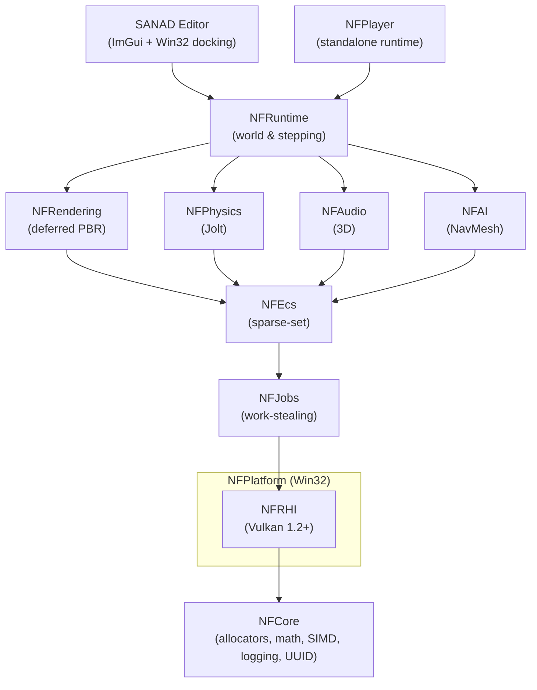

<div align="center">


# SANAD Engine · محرك سَنَد

**A modern C++23 + Vulkan 3D game engine — with an Arabic-first editor.**
<br>
محرك ألعاب ثلاثي الأبعاد مكتوب بـ C++23 وVulkan — ومحرر يتكلم العربية من أول يوم.

<a href="https://github.com/abdallah2183/SANAD-Engine/releases/tag/v0.2.0"></a>
<a href="LICENSE"></a>
<a href="#"></a>
<a href="#"></a>
<a href="#"></a>
<a href="#"></a>
<a href="AGENTS.md"></a>
<a href="CONTRIBUTING.md"></a>

<br>

[**Download 0.2.0**](https://github.com/abdallah2183/SANAD-Engine/releases/tag/v0.2.0) ·
[**Watch the 43s demo**](Docs/media/demo.mp4) ·
[**Docs**](Docs/) ·
[**العربية**](README.ar.md)

<br>


</div>

---

> [!IMPORTANT]
> **0.2.0 is a public demo, not a beta.** It ships as a **portable Windows x64 zip**.
> The executables are **unsigned** — Windows Smart App Control or WDAC may block
> them; if that happens, check the signature/policy warning rather than disabling
> your security settings. A Vulkan-capable GPU driver is required.

## 🌟 Why SANAD?

- **Arabic-first, not Arabic-later.** The editor ships a UCD-verified Arabic text
  shaper (contextual forms, lam-alef ligatures, full bidi), the Amiri font, and a
  complete English/Arabic UI. The launcher, editor, guide, and save prompts are all
  usable in Arabic.
- **A real editor, not a demo shell.** Docking layout, scene outliner, reflected
  inspector, translate/rotate/scale gizmos, undo/redo, asset browser, hot reload,
  and a **Start Here** guide that gets a new user to a playable scene.
- **Built like an engine.** C++23, a Vulkan 1.2+ RHI, a data-oriented sparse-set
  ECS, a DAG RenderGraph, and strict module layering enforced in CI.
- **AI-ready, not AI-washed.** The repo, the CLI, and every generated project
  carry the same executable contract, so an agent makes a native `.nfproj`
  instead of drifting into a web stub.
- **End-to-end workflow.** Create a project, add objects, press **Play**, save with
  a close guard and recovery copy, then package a standalone player.
- **Open source.** Apache-2.0 — use it, learn from it, or build on it.

## 🚀 Quick start

### 1. Download

Grab the portable build from the [0.2.0 release](https://github.com/abdallah2183/SANAD-Engine/releases/tag/v0.2.0):

| File | What to do |
|:---|:---|
| [`SANAD-0.2.0-Windows-x64-Portable.zip`](https://github.com/abdallah2183/SANAD-Engine/releases/download/v0.2.0/SANAD-0.2.0-Windows-x64-Portable.zip) | Extract anywhere → run `SANADEditor.exe` |
| [`SANAD_Engine_0.2.0_Demo.mp4`](https://github.com/abdallah2183/SANAD-Engine/releases/download/v0.2.0/SANAD_Engine_0.2.0_Demo.mp4) | The 43-second demo video (also in `Docs/media/`) |

> [!NOTE]
> There is **no installer in this demo** and no code signing yet. Windows may show
> "Unknown publisher". The release is Windows 10/11 x64 only.

### 2. Make something in 30 seconds

1. `SANADEditor.exe` → **Create New Project**
2. Pick **Third-Person**, name it, press **Create**
3. The scene opens with a Start Here guide → press **Play** (or `Ctrl+P`)

### 3. Or use the CLI

```bat
nf.exe new MyGame --name MyGame --template ThirdPerson
nf.exe build --project MyGame\MyGame.nfproj
cd MyGame\dist && NFPlayer.exe
```

## 🤖 Using an AI coding agent

SANAD is built to be driven by an agent, not replaced by a web toy. If you point
Claude Code, Codex, Cursor, or another coding agent at this repository:

- It reads [`AGENTS.md`](AGENTS.md) automatically; `CLAUDE.md`, `.cursor/rules/`,
  and `llms.txt` are entry points for the common tools.
- `nf guide` prints the same hard rule and workflow in the terminal.
- Every project created by `nf new` gets its own `AGENTS.md`, so an agent opened
  in the **game folder** also knows what to do.
- The executable recipe is in [`Docs/AI_Game_Guide.md`](Docs/AI_Game_Guide.md):
  create a `.nfproj`, edit `.nfscene` + Lua, then `nf run`.

**The hard rule:** a SANAD game is a native `.nfproj` built with `nf` — never an
`index.html`, a web server, or a Unity/Godot project.

## 🎬 See it in action

[](Docs/media/demo.mp4)

*43 seconds, no voice-over: launcher → editor → build → Play → save guard → portable package.*

| Launcher (Arabic) | Editor (Arabic RTL) |
|:---:|:---:|
|  |  |

| Vehicle demo | Work protection |
|:---:|:---:|
|  |  |

## 🎮 Sample game: TreeWorld

A complete playable game built entirely from SANAD data — a low-poly explorer
walking a misty forest, collecting five fireflies. Source, scene, Lua, materials,
and procedural textures live in [`Games/TreeWorld`](Games/TreeWorld); the style
is deliberately low-poly because the engine ships primitive meshes, not a scanned
forest pack.


```bat
build\Release\bin\nf.exe run --project Games\TreeWorld\TreeWorld.nfproj
```

> [!NOTE]
> TreeWorld lives on **`main`** and is built from source. The packaged **0.2.0**
> portable zip below predates it, so use `build_nf.bat Release` (or a newer
> release) to play the sample.

## 🧪 Latest on `main` (after 0.2.0)

- **Agent-ready from the first command.** `AGENTS.md`, `CLAUDE.md`, Cursor rules,
  `llms.txt`, a per-project `AGENTS.md`, and `nf guide` all teach an AI the same
  native scene/Lua workflow — no HTML fallback.
- **Lua gameplay that can finish a game.** Named actions (`nf.action`), analog
  axes (`nf.axis`), entity lookup (`nf.find_entity`), names, counts, positions,
  scales, and alive checks.
- **A playable starter.** `nf new --template ThirdPerson` now creates **Crate
  Hunter** — a real collect-and-win game, not a walk-around scene.
- **Editor safety.** Subtree duplicate (`Ctrl+D`) and a recovery draft with
  **File → Recover Last Draft**.
- **Authored atmosphere.** Distance fog in `PostProcess:`, plus the TreeWorld
  sample with PBR materials, shadows, bloom, and ACES grading.

## ✨ What's in 0.2.0

- **Neutral, focused editor UI** — state uses one blue accent instead of decorating
  every control, so the viewport stays the star.
- **Arabic RTL everywhere** — menus, panels, tooltips, onboarding, and the save
  prompt; text is shaped, not reversed.
- **No work loss** — closing a dirty scene asks **Save / Discard / Cancel**, and a
  recovery copy is written before the editor exits.
- **Play that behaves** — the standalone player restores and focuses its own
  window instead of opening behind the editor.
- **Portable templates** — the packaged editor finds its templates next to the
  executable, so a fresh folder can create a Third-Person project without the dev
  tree.
- **Docs that match the build** — [demo notes](Docs/Demo_Release.md),
  [release notes](RELEASE_NOTES_0.2.0.md), and a five-minute quick start.

## 🧱 Features

| Area | What it does |
|:---|:---|
| **Rendering** | Vulkan 1.2+ RHI, DAG RenderGraph, deferred PBR (GGX), cascaded shadows, procedural sky, sky-baked IBL, SSAO, bloom/grading/tonemap, GPU picking, LOD |
| **Editor** | ImGui docking shell, outliner, reflected inspector, gizmos, undo/redo, asset browser, Start Here guide, Arabic RTL UI |
| **Physics** | Deterministic solver plus Jolt Physics (vehicles, ragdolls, CCD, heightfields, compound bodies), PBD cloth |
| **Scripting** | Sandboxed Lua 5.4 (`nf.*` API, entity bindings) and C# via a .NET 10 sandbox host |
| **Assets** | glTF/GLB, OBJ, STL, PLY and `.nfmesh` import; asset cooker; material/texture pipeline; hot reload |
| **Audio** | 3D spatial audio on WASAPI; WAV/OGG/MP3/FLAC import |
| **2D** | `NFScene2D`: cameras, sprite batching, tile chunks, 2D physics, A* |
| **Gameplay** | Tags, quests, inventory, dialogue, input replays; grid A* + behavior trees; NavMesh |
| **Tools** | `nf` CLI (`new` / `build` / `verify` / `run`), asset cooker, model importer, standalone player |

<details>
<summary><b>Quality gates</b></summary>

- Clean MSVC `/W4 /WX` build.
- **26 test suites, 1,875 passed / 0 failed / 2 skipped** on Windows x64 (Release).
- 0 Vulkan validation errors and 0 leaked RHI objects in the editor acceptance run.
- End-to-end check: create a project with `nf`, build it, package it, and run the
  shipped player without the dev-tree shaders.

</details>

## 🏗 Architecture



Strict layering is checked by `Scripts/check_layering.sh` in CI.

## 🔧 Build from source

**Prerequisites:** Windows 10/11 x64, Visual Studio 2022 (or newer) with the
**Desktop development with C++** workload, CMake 3.25+, Ninja, and the Vulkan SDK
1.3+ (`glslc` on `PATH`).

```bat
git clone https://github.com/abdallah2183/SANAD-Engine.git
cd SANAD-Engine
build_nf.bat Release
```

The script discovers Visual Studio with `vswhere`, sets up MSVC + the Windows SDK,
configures CMake, and builds. No machine-specific paths are required.

```bat
:: run the editor
build\Release\bin\SANADEditor.exe

:: run one test suite
build\Release\bin\RuntimeTests.exe
```

<details>
<summary><b>Manual CMake / presets</b></summary>

```bat
cmake --preset release
cmake --build build/release
```

Or configure by hand:

```bat
cmake -S . -B build\release -G Ninja -DCMAKE_BUILD_TYPE=Release ^
      -DNF_BUILD_TESTS=ON -DNF_BUILD_SAMPLES=ON -DNF_BUILD_TOOLS=ON -DNF_BUILD_EDITOR=ON
cmake --build build\release --parallel
```

</details>

> [!NOTE]
> The release script `packaging/windows/build_installer.ps1` can produce an Inno
> Setup installer on a machine that has Inno Setup. The 0.2.0 demo intentionally
> ships the portable zip only.

## 🎮 Make a game

```bat
:: 1. create a project from a template
build\Release\bin\nf.exe new MyGame --name MyGame --template ThirdPerson

:: 2. build a standalone package
build\Release\bin\nf.exe build --project MyGame\MyGame.nfproj

:: 3. run the packaged player
cd MyGame\dist
NFPlayer.exe
```

- Import models with **File → Import** or `NFModelImporter.exe`
  ([formats](Docs/Asset_Import.md)).
- Blender characters: use the shipped add-on
  ([pipeline](Docs/Blender_Pipeline.md)).
- New here? [Getting Started (AR)](Docs/Getting_Started_Ar.md) ·
  [20-minute tutorial (AR)](Docs/Tutorial_Ar.md) ·
  [Lua scripting (AR)](Docs/Lua_Scripting_Ar.md).

Templates: `Default`, `ThirdPerson`, `FPSStarter`, `Platformer2D`.

## 🧩 Samples

Run from `build\Release\bin\`; most accept `--frames N` for bounded runs.

| Sample | Shows |
|:---|:---|
| `NFSampleCliffStory` — حكاية الجرف | Complete 2D story-climb on `NFScene2D` (65 ledges, dusk→night, shaped Arabic text) |
| `NFSampleVehicleDemo` | Jolt vehicle, chase camera, destructible crates |
| [`Games/TreeWorld`](Games/TreeWorld) | Full game source: third-person movement, fog, PBR materials, five collectibles |
| Others | Triangle, Basic3D, Water, Audio, Animation, GameUI, RuntimeScene, MedievalVillage, … |

## 📁 Project structure

```
Engine/        Core, RHI (Vulkan), Rendering, ECS, Scene, Physics, Audio, AI, … (23 subsystems)
Editor/        ImGui editor + Arabic launcher
Games/         Complete sample games (TreeWorld)
Tools/         nf CLI, AssetCooker, ModelImporter, Player, ProjectTool
Samples/       Playable demos (CliffStory, VehicleDemo, …)
Templates/     Starter projects (Default, ThirdPerson, FPSStarter, Platformer2D)
Tests/         26 suites
Docs/          Guides, design doc, release notes
ThirdParty/    Jolt, Dear ImGui, Lua, miniaudio, stb, cgltf
packaging/     Installer + portable zip scripts
website/       Showcase site source
```

## 🗺 Roadmap

Phases 1–29 are in the tree (rendering, editor, physics, scripting, networking,
2D, destruction, cascaded shadows, SSAO, PBR maps, sky IBL, navmesh, Jolt
vehicles). The demo release focuses on the workflow a new user actually
touches.

Next up: signed Windows builds, an installer in the release, Linux exploration,
and more first-party samples.

Full history: [ROADMAP.md](ROADMAP.md) ·
design: [Docs/SANAD_Engine_Complete_Design.md](Docs/SANAD_Engine_Complete_Design.md) ·
doc index: [Docs/README.md](Docs/README.md).

## 🤝 Contributing

Fork → branch → build → zero validation errors → pull request. Issues tagged
**`good first issue`** are beginner-friendly (docs, samples, editor UX).

**نداء للمبدعين العرب:** نرحّب بمبرمجي C++ والرسوميات والفيزياء والصوتيات
واجهات المحرر وكتّاب التوثيق — المشروع مصمّم طبقيًا ليتّسع للجميع.

Details: [CONTRIBUTING.md](CONTRIBUTING.md) · [CODE_OF_CONDUCT.md](CODE_OF_CONDUCT.md) ·
[SECURITY.md](SECURITY.md).

## 🔐 Security

Report vulnerabilities privately through GitHub's **Security → Report a
vulnerability** flow. Please do not open a public issue with a working exploit.
The full policy, supported versions, and the unsigned-binary caveat are in
[`SECURITY.md`](SECURITY.md).

## 📜 License & acknowledgements

Apache License 2.0 — see [LICENSE](LICENSE).

Built on **Jolt Physics**, **Dear ImGui**, **Amiri**, **Lua 5.4**, **miniaudio**,
**stb**, **cgltf**, the **.NET** runtime, and the **Vulkan SDK**.

<br>

<div align="center">

<a href="https://star-history.com/#abdallah2183/SANAD-Engine&Date">
  
</a>

</div>
